# Casa São Domingos Sávio: Gestão de Alunos

<p align="center">
  
</p>

Aplicativo mobile para gerenciar os alunos atendidos pela **Casa São Domingos Sávio**, instituição sem fins lucrativos de Campina Grande (PB) que acolhe cerca de 60 crianças entre 7 e 15 anos. Hoje as fichas dos alunos ficam em papel e espalhadas em arquivos digitais. O app junta tudo em um só lugar, guarda a linha do tempo de cada aluno e mostra indicadores sociais para a gestão e para a prestação de contas.

Projeto 1 da disciplina **Programação para Dispositivos Móveis (2026.2)**, CST em Análise e Desenvolvimento de Sistemas, IFPB Campus Esperança. **Todos os dados ficam salvos apenas no aparelho.**

## Tema

A entidade principal é o **aluno**. A ficha cadastral tem mais de 40 campos, organizados em:

- dados pessoais;
- informações sociais;
- dados da família;
- endereço;
- dados escolares;
- informações adicionais;
- histórico médico.

Cada aluno tem um **histórico** (linha do tempo) que não pode ser alterado. O app também calcula um **índice de vulnerabilidade social** para cada aluno.

## Funcionalidades

| Requisito | Onde está no app |
|---|---|
| **RF01: CRUD completo** | Cadastrar, listar, ver a ficha, editar e excluir alunos. |
| **RF02: Persistência local** | Banco SQLite (`expo-sqlite`). Alunos, usuários, sessão de login e tema continuam salvos depois de fechar o app. |
| **RF03: Listagem inteligente** | Busca por nome. Filtros por série, bairro e Bolsa Família. Ordenação por nome, data de cadastro ou idade. |
| **RF04: Validação** | Campos obrigatórios, data real e não futura, CPF com dígito verificador, CEP, telefone, email, senha de 8 caracteres ou mais, email e CPF únicos. |
| **RF05: Navegação** | Expo Router com telas de login, listagem, formulário, ficha (detalhe), histórico, dashboard e conta. |
| **RF06: Feedback** | Confirmação antes de excluir. Mensagens de sucesso e erro. Erros mostrados em cada campo. Indicadores de carregamento. |

Também foram implementados:

- **Login e perfis:** o primeiro acesso cria o administrador. Só administradores cadastram novos usuários. A senha é guardada como hash SHA-256 com salt, e a sessão continua ativa ao reabrir o app. Cada perfil vê uma parte do app:

  | Perfil | O que acessa |
  |---|---|
  | **Administrador** | Tudo, inclusive o cadastro de usuários. |
  | **Coordenador** | Alunos, oficinas, calendário (edição total), relatórios de comportamento e dashboard. |
  | **Professor** | Só a agenda das próprias oficinas, a lista de presença e os relatórios de comportamento. |

- **Oficinas:** cada oficina tem local, um ou mais professores vinculados e os alunos matriculados.
- **Calendário anual:** a coordenação monta as aulas de cada oficina (dias da semana, horário e período) ou cria aulas avulsas. Também remarca ou cancela aulas com **justificativa obrigatória**, por exemplo quando o professor avisa que não poderá comparecer. A data original fica registrada. O professor só visualiza os dias das suas oficinas, já com as mudanças e as justificativas.
- **Lista de presença:** no dia da aula (ou depois), o professor marca quem veio e quem faltou. Não é possível fazer chamada de aula futura ou cancelada.
- **Relatórios de comportamento:** na chamada, o professor pode escrever um relato sobre um aluno, que não pode ser alterado depois. A coordenação lê o relato, liga ou manda WhatsApp para os responsáveis direto do app e registra o contato. Esse contato entra no histórico da criança.
- **Histórico de cada criança:** a ficha mostra as oficinas em que ela está matriculada, a frequência por oficina (com alerta abaixo de 75%), as últimas chamadas, os relatórios de comportamento e a linha do tempo.
- **Histórico do aluno:** linha do tempo do registro mais recente para o mais antigo, com o usuário responsável por cada registro. Mudanças de série e de escola entram no histórico automaticamente.
- **Dashboard de análise social**, com:
  - filtros por ano, série e bairro;
  - indicadores principais;
  - gráficos de idade, gênero, raça/cor, escolaridade dos pais, profissões, tamanho das famílias, bairros, escolas e saúde;
  - índice de vulnerabilidade;
  - tabela com busca, ordenação e paginação.
- **Auditoria:** quem criou, editou ou excluiu cada registro, e quando.

### Itens opcionais (pontuação extra)

- [x] Tema claro/escuro: automático ou escolhido pelo usuário, salvo no banco.
- [x] Gráficos e estatísticas: dashboard de análise social.
- [x] Exportação de dados: relatório em PDF compartilhável (`expo-print` + `expo-sharing`).
- [ ] Notificações locais.

## Tecnologias

- **React Native 0.88** com **Expo SDK 58**
- **Expo Router** para navegação por arquivos e rotas protegidas por login (`Stack.Protected`)
- **expo-sqlite** para persistência local
- **expo-crypto** para o hash das senhas
- **expo-print** e **expo-sharing** para o relatório em PDF
- **react-native-svg** para o gráfico de rosca
- **expo-symbols** para os ícones (SF Symbols no iOS, Material Symbols no Android)
- **TypeScript**, **ESLint** e **Jest** (`jest-expo`)

## Como executar

Pré-requisitos: [Node.js](https://nodejs.org) 20 ou mais recente e o app **Expo Go** no celular Android (ou um emulador Android).

```bash
# 1. Instalar as dependências
npm install

# 2. Iniciar o servidor de desenvolvimento
npx expo start
```

Depois disso:

- **Celular Android:** abra o Expo Go e escaneie o QR Code que aparece no terminal.
- **Emulador Android:** com o emulador aberto, pressione `a` no terminal.

No primeiro acesso, o app pede o cadastro do **administrador**. Para a demonstração, use o botão **"Gerar dados de demonstração"** na aba **Conta**. Ele cria um ano letivo fictício:

- 40 alunos;
- a equipe (1 coordenadora e 5 professores);
- as 9 oficinas da Casa, com matrículas;
- o calendário de fevereiro a dezembro, com aulas remarcadas e canceladas;
- as chamadas das aulas que já aconteceram;
- relatórios de comportamento em vários estágios.

Contas de demonstração (todas com a senha `casa1234`):

| Perfil | Email |
|---|---|
| Coordenadora | `coordenacao@casa.org` |
| Professor (Judô e Educação Física) | `judo@casa.org` |
| Professora (Artes) | `artes@casa.org` |
| Professor (Música e Informática) | `musica@casa.org` |
| Professora (Balé e Dança) | `danca@casa.org` |
| Professora (Reforço escolar e Evangelização) | `reforco@casa.org` |

### Outros comandos

```bash
npm test             # testes automatizados (regras de negócio e banco SQLite)
npx expo lint        # lint
npx tsc --noEmit     # verificação de tipos
```

## Estrutura do projeto

```
src/
├── app/                  # Telas (Expo Router)
│   ├── _layout.tsx       # Provedores (SQLite, auth, tema, toast) e rotas protegidas
│   ├── login.tsx
│   ├── primeiro-acesso.tsx
│   ├── (tabs)/           # Abas: Agenda, Alunos, Relatórios, Análise social, Conta
│   ├── alunos/           # novo, [id] (ficha), [id]/editar, [id]/historico
│   ├── aulas/            # [id] (aula), [id]/chamada, [id]/relatorio, [id]/editar
│   ├── calendario/       # planejar (calendário anual)
│   ├── oficinas/         # lista, nova, [id]
│   ├── relatorios/       # [id] (relatório de comportamento)
│   └── usuarios/novo.tsx
├── components/           # Componentes de interface (formulários, gráficos, ui/)
├── context/              # Sessão do usuário, tema e mensagens (toast)
├── database/             # Camada de dados: esquema/migrações e repositórios SQLite
├── lib/                  # Regras puras: validação, formatação, estatísticas, vulnerabilidade
├── services/             # Geração do relatório PDF
└── constants/            # Paleta de cores e listas de opções
```

As telas não escrevem SQL. Elas chamam os **repositórios** em `src/database/`, e as regras de negócio (validação, cálculos) ficam em `src/lib/` como funções puras, cobertas por testes.

## Capturas de tela

Prints tirados do app rodando no Expo Go, com os dados de demonstração.

### Acesso

| Primeiro acesso | Login | Novo usuário (admin) |
|:---:|:---:|:---:|
| 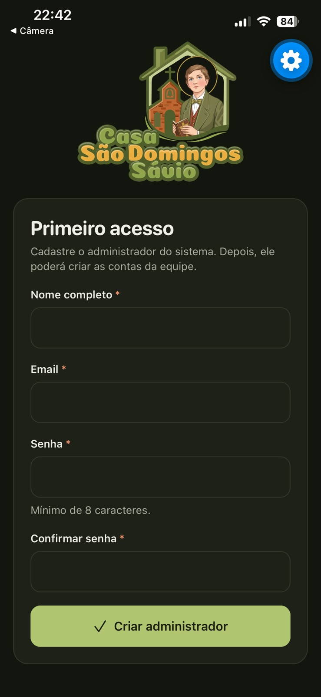 | 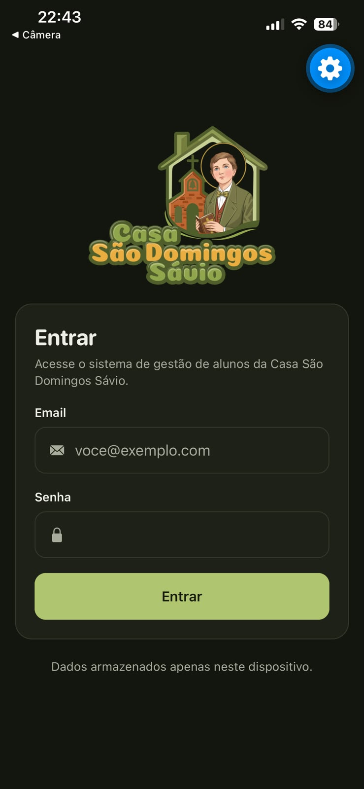 | 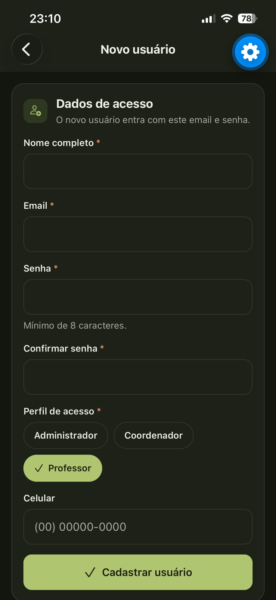 |

### Coordenação

| Agenda | Planejar calendário | Oficinas |
|:---:|:---:|:---:|
| 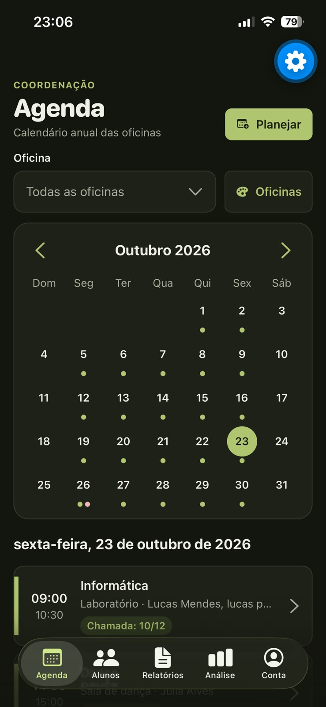 | 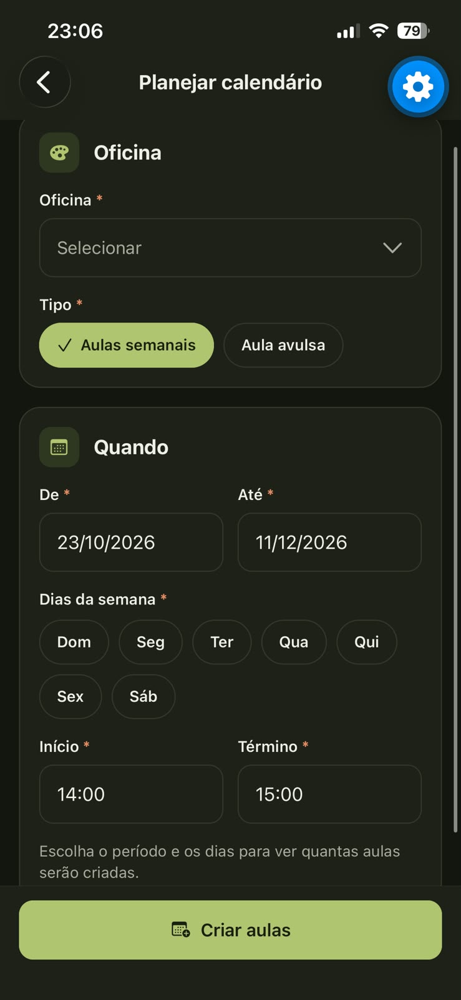 | 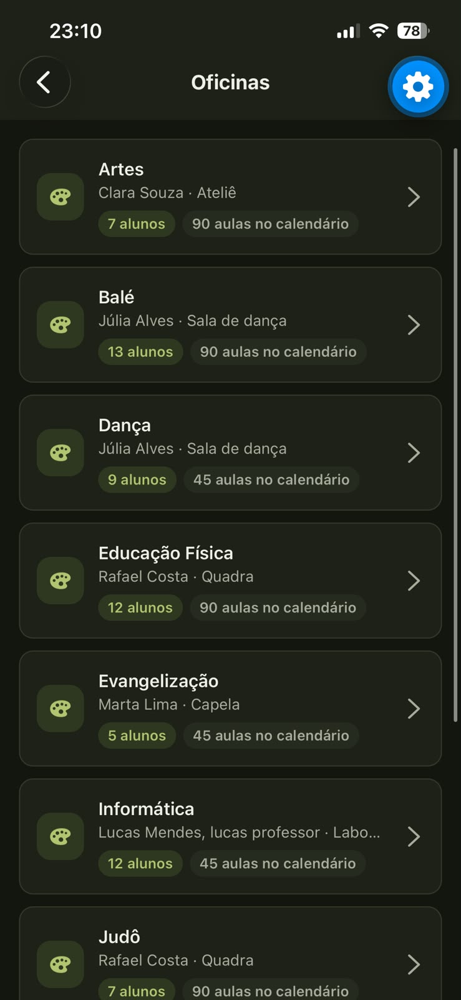 |

| Alunos (busca e filtros) | Relatórios de comportamento | Contato realizado |
|:---:|:---:|:---:|
| 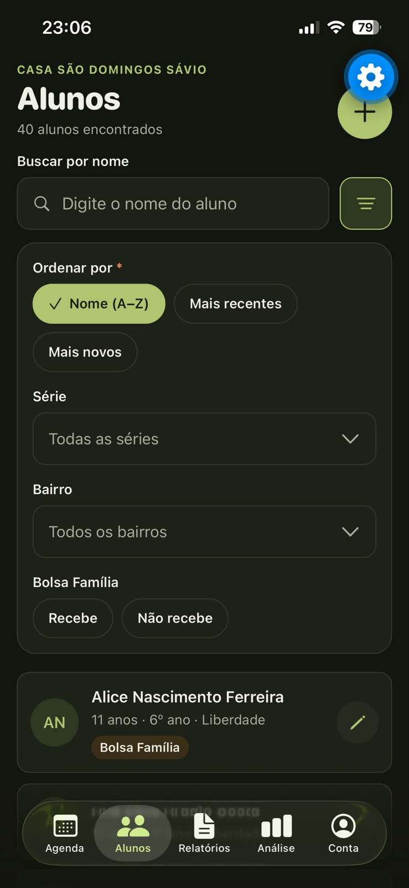 | 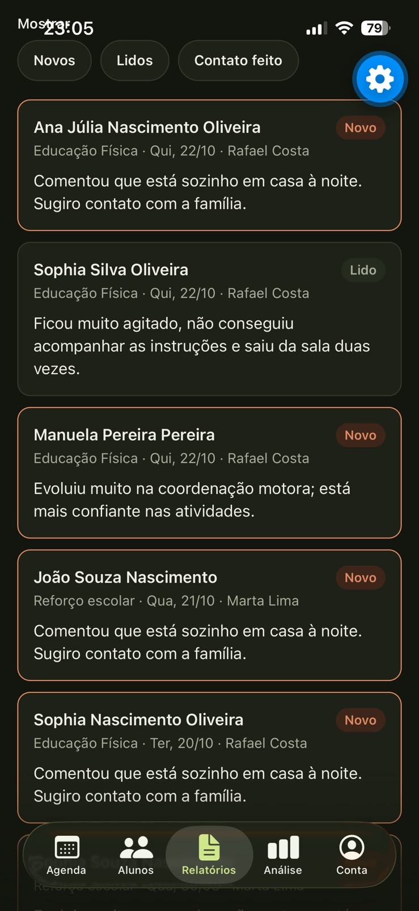 | 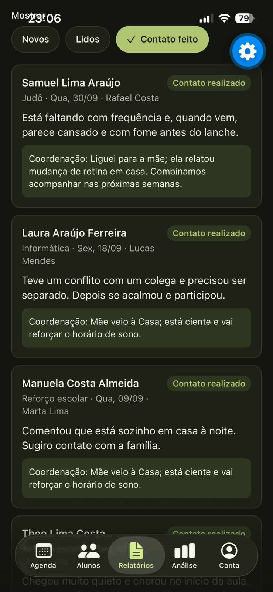 |

### Professor (tema claro)

| Minhas aulas | Lista de presença | Relatório de comportamento |
|:---:|:---:|:---:|
| 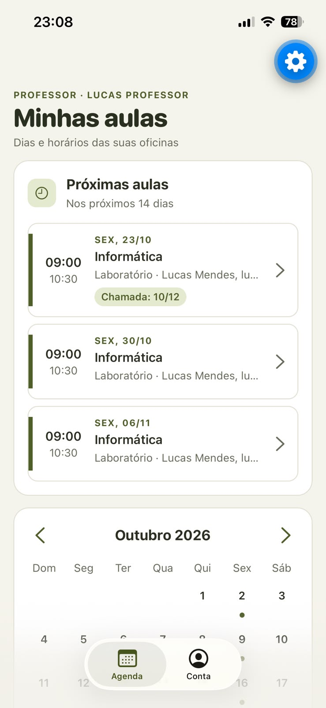 |  |  |

### Análise social

| Indicadores | Gráficos |
|:---:|:---:|
| 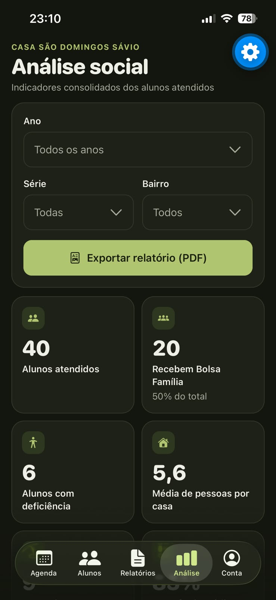 | 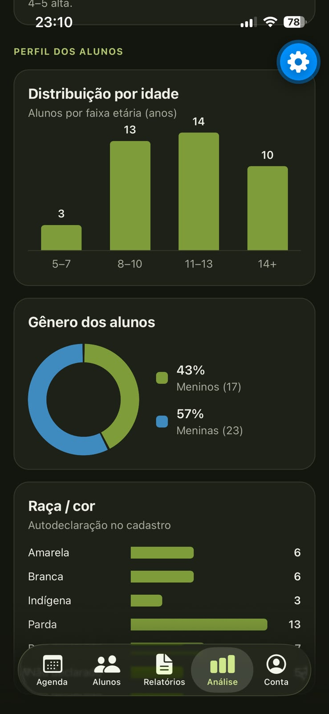 |

Exemplo do relatório exportado: [docs/prints/relatorio.pdf](docs/prints/relatorio.pdf).

## Documentação

A documentação com tema, modelo de dados e justificativa da persistência está em [docs/DOCUMENTACAO.md](docs/DOCUMENTACAO.md).

## Integrantes

- Lucas Barbosa Graciano
- Valdênio Pantaleão
- Pedro Pereira

## Créditos

A logomarca pertence à Casa São Domingos Sávio. Os dados de exemplo são fictícios.
