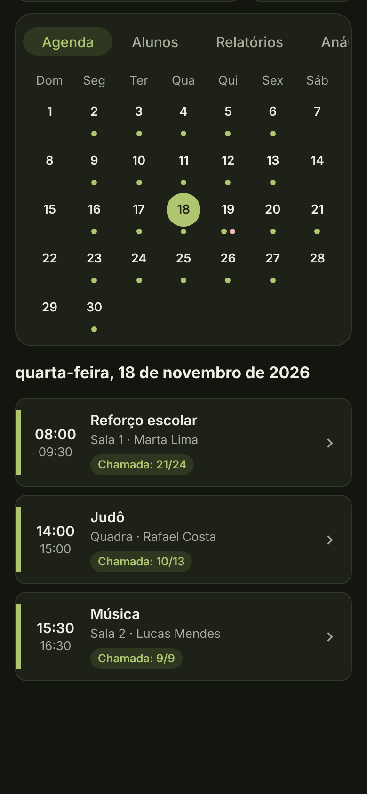
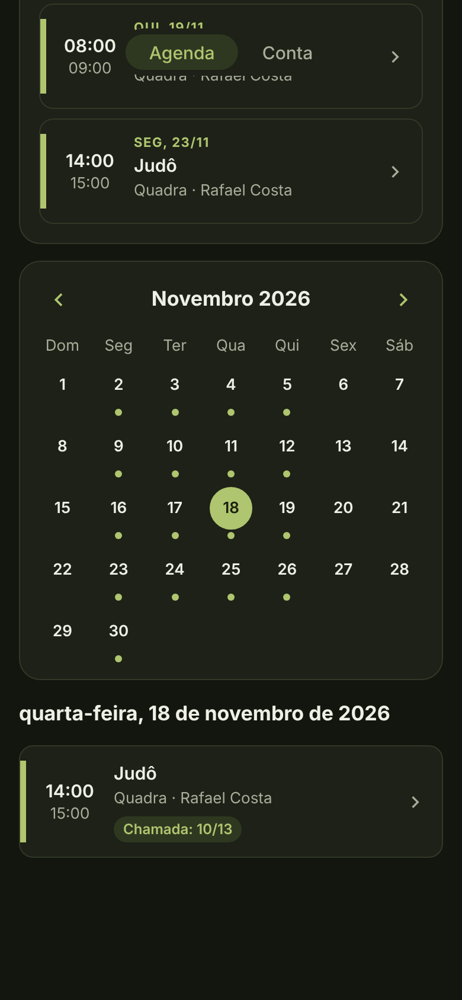
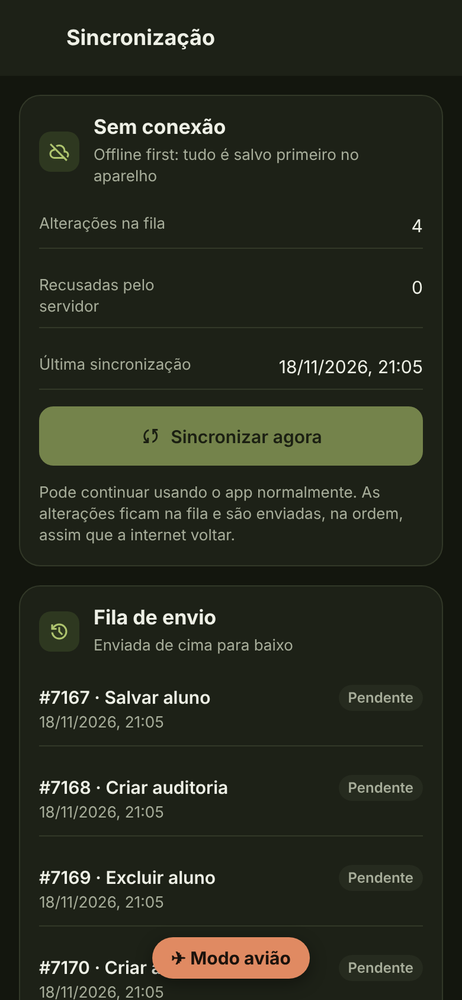
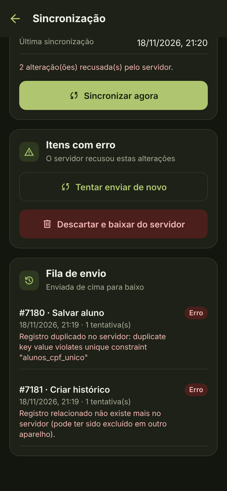
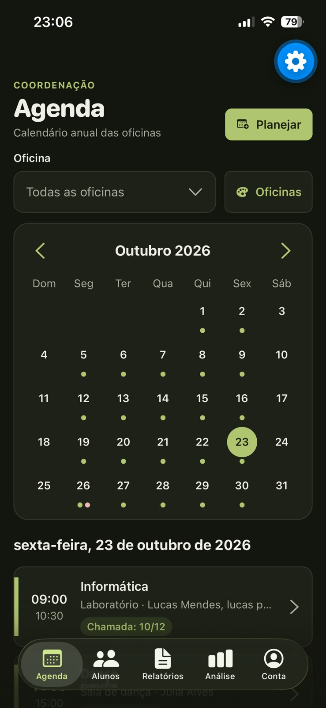
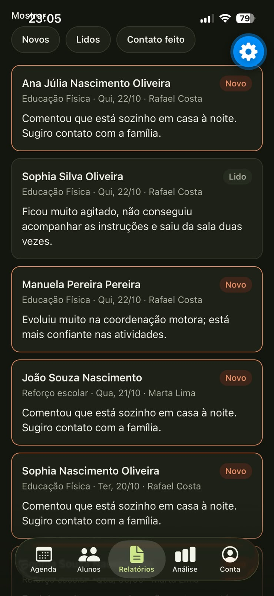
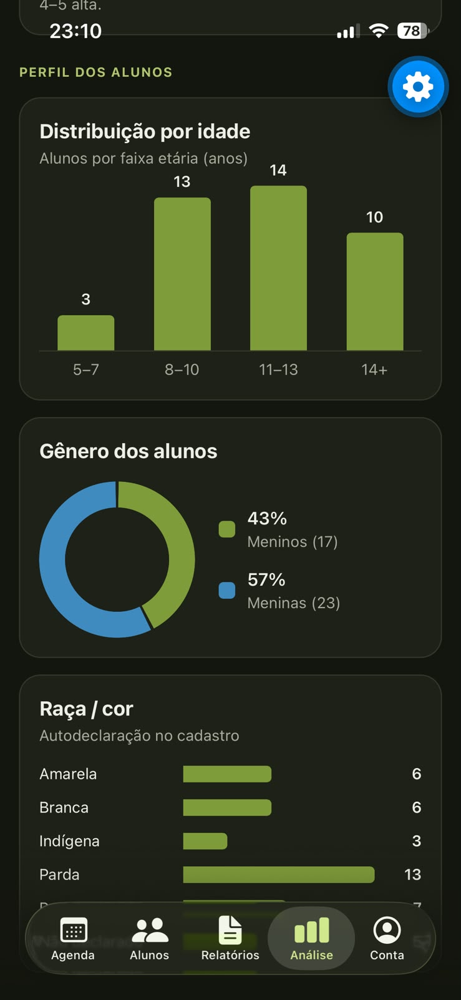

# Casa São Domingos Sávio: App de Gestão de Alunos

**Disciplina:** Programação para Dispositivos Móveis 2026.2, IFPB Campus Esperança. Prof. André Atanasio.
**Tecnologia:** React Native + Expo SDK 58. P1: persistência local em SQLite (`expo-sqlite`). P2: backend no Supabase (Postgres, Auth, Edge Function) com sincronização offline first.
**Versão em PDF:** [DOCUMENTACAO.pdf](DOCUMENTACAO.pdf)
**Vídeo de demonstração (P2):** https://youtu.be/a5yAvp3g-Kg

## 1. Tema

A Casa São Domingos Sávio, de Campina Grande (PB), atende cerca de 60 crianças de 7 a 15 anos com oficinas, reforço escolar e refeições. As fichas dos alunos ficavam em papel, sem cópia de segurança. O app reúne tudo no celular, funciona sem internet e, desde o P2, guarda tudo também na nuvem, compartilhado entre os aparelhos da equipe.

| Perfil | O que faz no app |
|---|---|
| **Administrador** | Tudo, inclusive cadastrar usuários. |
| **Coordenador** | CRUD da ficha do aluno, oficinas e matrículas, calendário anual (remarcar ou cancelar com justificativa), leitura dos relatórios e contato com os responsáveis, dashboard com exportação em PDF. |
| **Professor** | Vê só os dias das próprias oficinas, faz a lista de presença e escreve relatórios de comportamento. |

Cada criança tem um histórico com frequência por oficina, relatórios de comportamento e uma linha do tempo que não pode ser alterada.

## 2. Modelo de dados

```
usuarios ──< oficina_professores >── oficinas ──< oficina_alunos >── alunos
   │                                    └──< aulas ──< presencas >───────┤
   │                                           └──< relatorios_comportamento
   └──< historico, auditoria        local: preferencias · fila_sincronizacao
                                     servidor: exclusoes (registro de exclusões)
```

Desde o P2, as chaves são **UUIDs gerados no aparelho**, iguais no SQLite e no Postgres, para que registros criados offline em aparelhos diferentes nunca colidam. Toda tabela tem `updated_at`, que no servidor é definido por trigger com o relógio do servidor.

| Tabela | Campos principais | Regras no banco |
|---|---|---|
| **alunos** (entidade principal) | Mais de 40 campos da ficha: dados pessoais, sociais, família, endereço, escola e saúde | `NOT NULL` em nome, nascimento, mãe, bairro e cidade; sim/não com `CHECK (0,1)`; CPF único |
| **usuarios** | nome, email, perfil, telefone (id = conta do Supabase Auth) | Email único; a senha fica só no Supabase Auth; contas criadas apenas pela Edge Function |
| **oficinas** e vínculos | nome, local; professores e alunos (N:N) | Chaves compostas impedem duplicidade |
| **aulas** | oficina, data, horário, status, data original, justificativa | Término depois do início; remarcar ou cancelar exige justificativa (`CHECK`) |
| **presencas** | aula, aluno, presente | Uma marcação por aluno por aula |
| **relatorios_comportamento** | aluno, aula, professor, texto, status | *Trigger* impede alterar o texto do professor |
| **historico** e **auditoria** | eventos do aluno; quem fez o quê e quando | *Trigger* impede alterar o histórico |
| **fila_sincronizacao** (só no aparelho) | tabela, operação, chave, cópia do registro, tentativas, status, erro | Gravada na mesma transação da alteração; enviada em ordem |
| **exclusoes** (só no servidor) | tabela, chave, data | Preenchida por trigger em toda exclusão, inclusive em cascata |

## 3. Por que SQLite e não AsyncStorage

1. **Os dados são relacionais.** Alunos, oficinas, aulas, presenças e relatórios se ligam por chaves estrangeiras. No AsyncStorage (chave-valor) seria preciso guardar listas inteiras em JSON e manter as relações à mão.
2. **Consultas no banco.** Busca, filtros, ordenação e os totais do dashboard são feitos em SQL, com índices.
3. **Integridade garantida pelo banco.** `NOT NULL`, `UNIQUE`, `CHECK`, `FOREIGN KEY` e *triggers* valem mesmo se a interface falhar.
4. **Transações.** Cada cadastro grava ficha, histórico e auditoria juntos; se o app for interrompido, nada fica pela metade.
5. **Migrações versionadas** com `PRAGMA user_version`: o banco evoluiu da v1 para a v2 sem perder dados. A v3 (P2) trocou as chaves por UUIDs e criou a fila de sincronização.

As telas (`src/app`) não escrevem SQL; chamam repositórios (`src/database`). As regras de negócio ficam em `src/lib`. São **44 testes automatizados** (`npm test`) que rodam o SQL de verdade, incluindo fechar e reabrir o banco e simular a conexão caindo no meio do envio.

## 4. Backend e offline first (P2)

**Backend:** Supabase. O Postgres guarda as mesmas tabelas do aparelho, com as migrações versionadas em `supabase/migrations/`. O login usa o Supabase Auth. As contas da equipe são criadas pela Edge Function `gerenciar-usuarios`, porque criar contas exige a chave de administrador, que não pode ir dentro do app.

**Segurança:** *Row Level Security* em todas as tabelas, com as mesmas regras de perfil do app. O professor só lê os alunos, aulas e presenças das próprias oficinas. O histórico só aceita inserção, e o texto do relatório não pode ser alterado (triggers também no Postgres). Uma conta sem perfil cadastrado pelo administrador não vê nada.

**Offline first:**

1. A tela grava no SQLite. Na **mesma transação**, o registro (uma cópia da linha) entra em `fila_sincronizacao`. A tela responde na hora, com ou sem internet.
2. O sincronizador (`src/sync/engine.ts`) envia a fila **em ordem de criação**. Itens seguidos da mesma tabela vão num lote, e cada item só sai da fila depois da confirmação do servidor.
3. **Falha temporária** (sem internet, servidor fora, sessão expirada): o envio para sem perder a ordem e tenta de novo com *backoff* exponencial (2 s até 2 min). Também tenta quando a conexão volta (`expo-network`) e quando o app volta para a frente.
4. **Recusa definitiva** (regra de acesso, dado duplicado): o item fica com status "erro", aparece na tela Sincronização e não bloqueia os demais. O usuário pode tentar de novo ou descartar e baixar tudo do servidor.
5. **Idempotência:** como os IDs nascem no aparelho e o envio é *upsert*, reenviar um item que o servidor já recebeu não duplica nada.
6. **Recebimento:** depois do envio, o app baixa, tabela por tabela, as linhas com `updated_at` maior que o último recebido, e depois as exclusões. Registros com alteração local ainda na fila não são sobrescritos. Quando a fila sobe, vence a última escrita sincronizada.

| Precisa de internet | Funciona offline |
|---|---|
| Primeiro login no aparelho; cadastro de usuários | Todo o resto: alunos, histórico, oficinas, calendário, chamada, relatórios, dashboard, PDF |

## 5. Capturas de tela

**P2: perfis e sincronização**

| Coordenação | Professor | Fila offline | Recusa do servidor |
|:---:|:---:|:---:|:---:|
|  |  |  |  |

**P1**

| Agenda (coordenação) | Lista de presença (professor) | Relatórios | Análise social |
|:---:|:---:|:---:|:---:|
|  |  |  |  |
